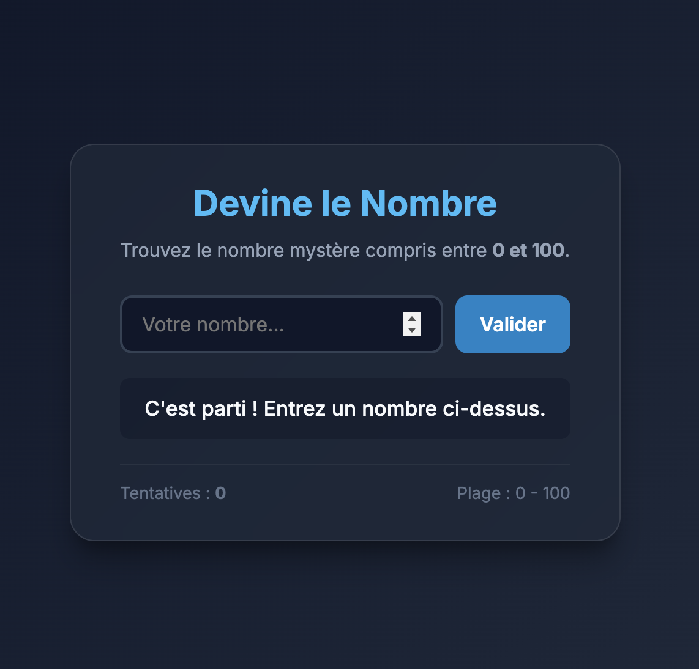
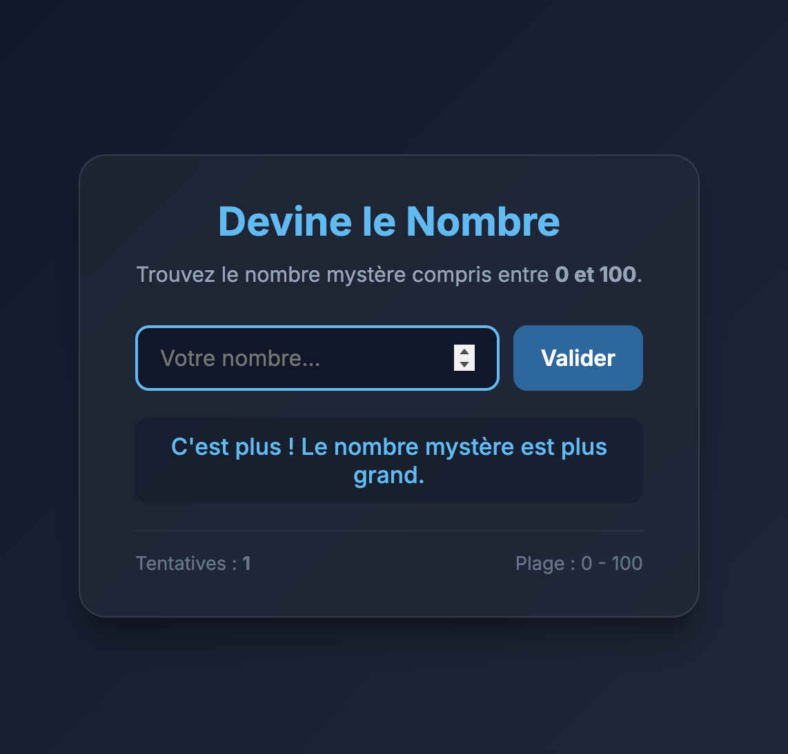
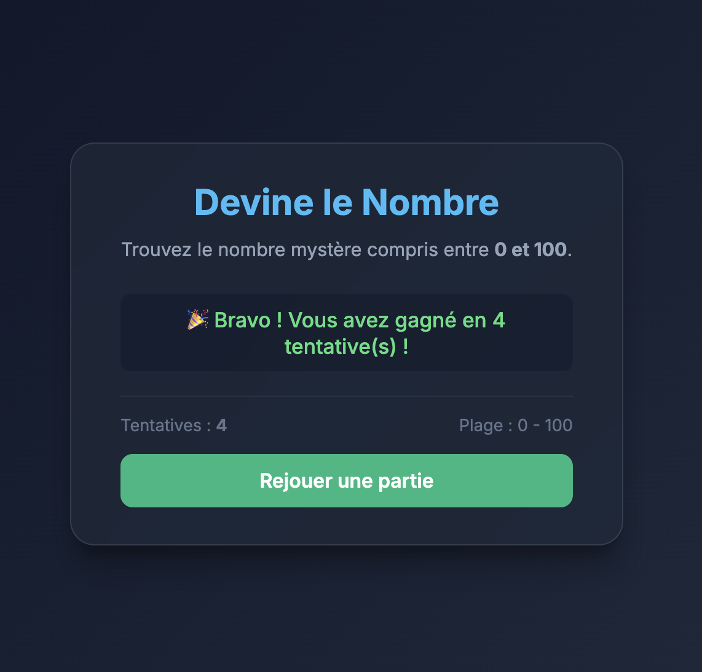

# Projet Web : Le Jeu du "Devine le Nombre"

Bienvenue dans ce projet d'initiation à la programmation web ! Ce document présente les objectifs, les règles et la structure du mini-jeu que vous allez créer pas à pas.

---

## 🎯 Objectifs pédagogiques

Ce projet a été conçu pour vous apprendre les bases fondamentales du **JavaScript** ainsi que son interaction avec les pages web, à travers un format ludique :

1. **Les Variables (`let`, `const`) :** Stocker des informations en mémoire (le nombre secret, le nombre d'essais, l'état du jeu).
2. **Le Hasard (`Math.random`) :** Générer de l'imprévisible pour rendre chaque partie unique.
3. **Le DOM (*Document Object Model*) :** Permettre à JavaScript de dialoguer avec le code HTML (lire les saisies, modifier l'affichage).
4. **Les Événements (`addEventListener`) :** Réagir en temps réel aux actions de l'utilisateur (clics de souris, appui sur la touche *Entrée*).
5. **Les Conditions (`if / else if / else`) :** Prendre des décisions logiques pour guider le joueur (trop grand, trop petit, gagné !).
6. **La Boucle événementielle :** Gérer l'enchaînement des tentatives jusqu'à la victoire.

---

## 📜 Les Règles du Jeu

Le jeu fonctionne selon les principes suivants :

1. Le programme choisit secrètement un nombre entier compris entre **0 et 100** (inclus).
2. Le programme invite le joueur à deviner ce nombre mystère via un champ de saisie .
3. Le joueur entre sa proposition (un nombre entier entre 0 et 100).
4. Le programme analyse la proposition :
   - Si le nombre entré est **plus grand** que le nombre mystère --> Le programme indique que le nombre mystère est **plus petit** (c'est moins) .
   - Si le nombre entré est **plus petit** que le nombre mystère -->Le programme indique que le nombre mystère est **plus grand** (c'est plus) .
   - Si les deux nombres sont **identiques** --> Le programme annonce que le joueur a **gagné la partie** ! .
5. Tant que la solution n'est pas trouvée, la partie continue et le compteur de tentatives augmente.

---

## 🛠️ Structure du Projet

Pour garder un code propre et structuré, votre projet sera divisé en trois fichiers distincts :
.
* `index.html` : La structure et l'interface visuelle de la page web. Le fichier est disponible ici : [./index.html].
* `style.css` : Le design, les couleurs et la mise en page (style moderne / glassmorphisme). Le fichier est disponible ici : [style.css](./style.css).
* `script.js` : Le cerveau du jeu (la logique, les conditions et les interactions). Le fichier **vide** est disponible ici : [script.js](./script.js) Mais vous pouvez utiliser [https://jsfiddle.net/](https://jsfiddle.net/) pour faire simple.

Préparez votre éditeur de code et vos fichiers, et commencez dès à présent avec la [première étape](./etape_1.md) !

---

## 📺 Autre projet : « Devine les Vues Stream »

Un deuxième mini-jeu pour s'entraîner : deviner le nombre de vues d'un live (entre 0 et 1000). On y revoit les variables, les conditions, les fonctions, les tableaux et les boucles `for`, avec un historique des essais.

* [Tutoriel pas à pas](./tiktok/tutoriel/01-introduction.md) : introduction, variables et saisie, conditions, tableau et boucle, code final.
* [Le jeu](./tiktok/index.html) et son script [app.js](./tiktok/app.js).

---

## ⚔️ Autre projet : « Mini RPG »

Un combat au tour par tour contre un monstre : barres de vie, attaque, soin et riposte automatique. On y travaille les variables, les fonctions, les conditions, les tableaux et les boucles `for` (journal de combat).

* [Tutoriel pas à pas](./mini-rpg/tutoriels/01-introduction.md) : introduction, variables et état, fonctions et actions, conditions et fin, tableau et boucle.
* [Le jeu](./mini-rpg/index.html), son style [style.css](./mini-rpg/style.css) et son script [app.js](./mini-rpg/app.js).
* [Version POO du Mini RPG](./mini-rpg/tutoriels/poo/01-introduction.md) : le même jeu transformé pas à pas en classes (`Personnage`, `Journal`, `Heros`/`Monstre` avec héritage, `Combat`). [Code final](./mini-rpg/tutoriels/poo/app.js) jouable via [index.html](./mini-rpg/tutoriels/poo/index.html).
* [Version API et carte du Mini RPG](./mini-rpg/tutoriels/api/01-introduction.md) : suite du cours POO. On charge des Pokémon depuis PokeAPI (`fetch`, `async` / `await`, `try` / `catch`), une carte découpée en tuiles depuis un fichier JSON, on déplace le héros avec collisions (bordures, obstacles), et les hautes herbes cachent des monstres qui déclenchent un combat, comme dans les vieux jeux Pokémon. 7 étapes courtes, chacune avec son [code complet](./mini-rpg/tutoriels/api/etapes/) pour se débloquer. [Code final](./mini-rpg/tutoriels/api/app.js), à servir avec un serveur local.
* [Version sons du Mini RPG](./mini-rpg/tutoriels/son/01-introduction.md) : suite du cours API. Une classe `Sons` (orientée objet, injectée dans `Exploration` et `Combat`) ajoute bruitages et musiques : pas, collisions, rencontre, combat, victoire, fondus entre la carte et le combat, bouton muet mémorisé (`localStorage`) et détection des fichiers manquants (`fetch`). Les sons sont déjà choisis sur [OpenGameArt](https://opengameart.org) (3 pages CC0, liens dans l'introduction) ; on les télécharge soi-même. 6 étapes, un jeu jouable avec du son à la fin de chacune, et le [code complet de chaque étape](./mini-rpg/tutoriels/son/etapes/). [Code final](./mini-rpg/tutoriels/son/app.js).
* [Version magie du Mini RPG](./mini-rpg/tutoriels/magie/01-introduction.md) : suite du cours sons. Un nouveau héros, le Mage, combat avec du mana et des sorts. On y pratique l'héritage (`Mage extends Heros`, `SortDeSoin extends Sort`), les objets dans un tableau (un bouton par sort) et le polymorphisme (écran de choix Chevalier / Mage). 6 étapes jouables, le [code complet de chaque étape](./mini-rpg/tutoriels/magie/etapes/) et le [code final](./mini-rpg/tutoriels/magie/app.js).
* [Écris ton histoire](./mini-rpg/tutoriels/histoire/01-introduction.md) : le dernier dossier. L'apprenant fait évoluer **son** Mini RPG (règles, personnages, monde, images et sons, début et fin de l'histoire) avec une méthode en 4 temps (imaginer, découper, trouver où, coder et tester). Chaque chapitre propose un exemple guidé, puis des idées classées par difficulté.
