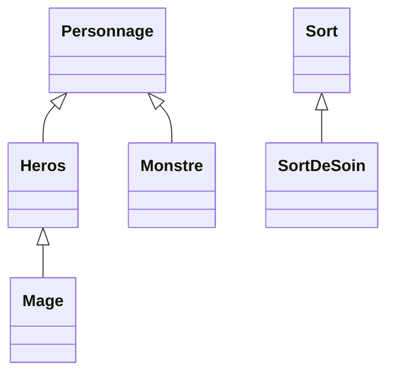

# 03 – La programmation orientée objet

La POO, c'est une façon de **ranger** un programme : au lieu de variables et de fonctions éparpillées, on fabrique des **objets** qui savent des choses et savent faire des choses. Ton jeu en compte **11 classes**.

## Classe et objet : le moule et le gâteau

**En une phrase** : une **classe** est un moule ; chaque **objet** fabriqué avec `new` est un gâteau sorti de ce moule.

```javascript
class Personnage {
    constructor(nom, pvMax, degatsMin, degatsMax) {
        this.nom = nom;      // ce que l'objet SAIT : ses propriétés
        this.pvMax = pvMax;
        this.pv = pvMax;
        this.degatsMin = degatsMin;
        this.degatsMax = degatsMax;
    }

    estVaincu() {            // ce que l'objet SAIT FAIRE : ses méthodes
        return this.pv <= 0;
    }
}

const gobelin = new Monstre("Gobelin", 80, 5, 15); // un objet
```

- `constructor` est appelé par `new` : il prépare l'objet ;
- `this` veut dire « **cet** objet-ci » : `this.pv`, c'est **ses** PV ;
- deux objets de la même classe ont chacun **leurs** valeurs : le Gobelin et Gengar n'ont pas les mêmes PV.

📍 Vu dans : [POO 02 – La classe Personnage](../poo/02-classe-personnage.md)

## L'héritage : « est un »

**En une phrase** : `class B extends A` crée une classe qui **hérite** de tout ce que sait faire `A`, et n'écrit que ce qui **change**.

```javascript
class Mage extends Heros {
    constructor(nom) {
        super(nom, 80, 4, 8);      // le constructeur du parent, avec les chiffres du Mage
        this.emoji = "🧙";
        this.manaMax = 50;         // ce que le Mage a EN PLUS
        this.mana = this.manaMax;
    }
}
```

L'arbre des classes de ton jeu :



Un Mage **est un** héros, qui **est un** personnage : il sait attaquer, recevoir des dégâts, se soigner… sans une ligne de plus.

📍 Vu dans : [POO 04 – Héritage](../poo/04-heritage.md), [Magie 02 – Le Mage](../magie/02-mage.md)

## Redéfinir une méthode, et `super`

**En une phrase** : une classe enfant peut **remplacer** une méthode du parent, et appeler la version du parent avec `super.methode()` pour la **compléter**.

```javascript
// Dans Mage : après une défaite, PV ET mana au maximum
restaurer() {
    super.restaurer();          // ce que fait Personnage : les PV au maximum
    this.mana = this.manaMax;   // ce que le Mage ajoute
}
```

📍 Vu dans : [POO 04](../poo/04-heritage.md), [Magie 04 – Soin et mana](../magie/04-soin-et-mana.md)

## Le polymorphisme : même question, réponses différentes

**En une phrase** : le code demande « attaque ! » ou « lance-toi ! » à un objet **sans savoir lequel** c'est, et chaque objet répond **à sa façon**.

```javascript
// Dans Combat : "héros, lance ce sort", quel que soit le sort
this.journal.ajouter(this.heros.lancerSort(sort, this.monstre));
```

Si le sort est un `Sort`, il blesse le monstre. Si c'est un `SortDeSoin`, il soigne le héros. `Combat` ne fait **aucun** `if` pour le savoir. Pareil pour le Chevalier et le Mage : `Combat` crée « un bouton par sort », et pour le Chevalier, la liste est vide, donc… zéro bouton.

> La leçon de la faille corrigée dans `magie` : tout ce que `Combat` demande à « un héros », la classe `Heros` doit savoir le faire. Sinon, le code marche par chance.

📍 Vu dans : [Magie 04](../magie/04-soin-et-mana.md), [Magie 05 – Choisir son héros](../magie/05-choix-heros.md)

## Méthode `static` : une usine à objets

**En une phrase** : une méthode `static` appartient à la **classe** elle-même : on l'appelle sans objet, souvent pour **fabriquer** des objets.

```javascript
const gengar = await Monstre.depuisApi("gengar"); // la classe fabrique un monstre à partir de PokeAPI
```

📍 Vu dans : [API 02 – Gengar depuis l'API](../api/02-monstre-depuis-api.md)

## L'encapsulation : chaque objet garde ses secrets

**En une phrase** : les autres parties du programme **demandent un service** à un objet, sans savoir **comment** il s'y prend.

```javascript
this.sons.jouer("attaque");   // Combat ne touche jamais aux objets Audio
```

`Combat` ne sait pas que `Sons` fait une copie du son, règle le volume, gère le mode muet… Il demande, c'est tout. Si un jour on change la façon de jouer les sons, `Combat` ne bouge pas.

📍 Vu dans : [Son 02 – La classe Sons](../son/02-premier-son.md)

## 🧠 Prendre du recul

| Sans POO (les bases) | Avec la POO |
| --- | --- |
| `pvJoueur`, `pvMonstre` : une variable par combattant | `heros.pv`, `monstre.pv` : chaque objet a ses PV |
| une fonction `attaquer` pour le joueur, une `riposte` pour le monstre | une méthode `attaquer` dans `Personnage`, pour tout le monde |
| ajouter un 2e monstre = tout dupliquer | ajouter un monstre = `new Monstre(...)` |
| ajouter un Mage = réécrire beaucoup | ajouter un Mage = `class Mage extends Heros` et quelques lignes |

La POO n'a pas rendu le jeu **plus court** : elle l'a rendu **plus facile à faire grandir**. C'est grâce à elle que tu as pu ajouter les API, les sons, la magie et les animations sans tout casser.

➡️ Suite : [04 – Le web et l'asynchrone](./04-web-asynchrone.md)
