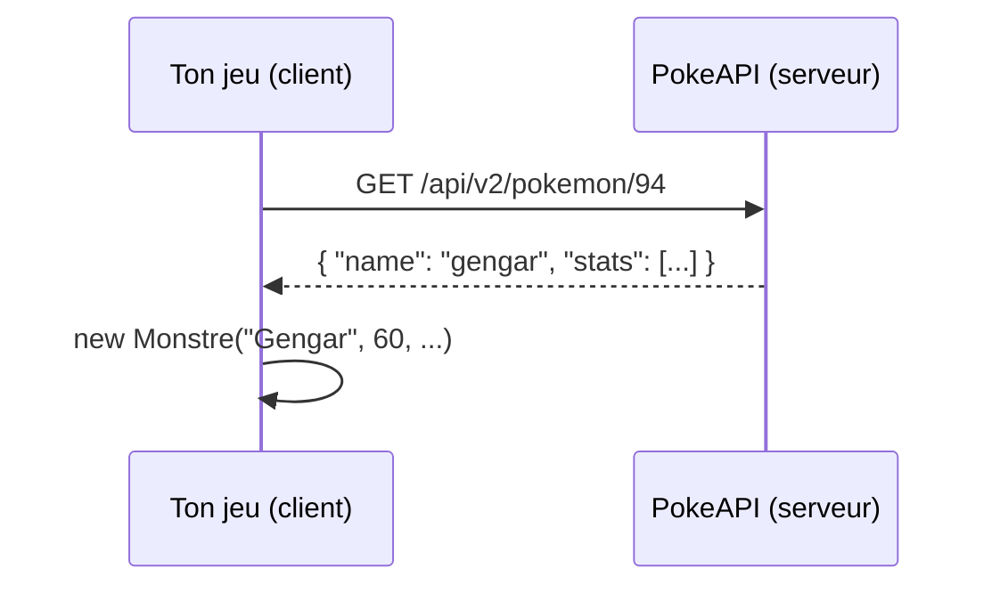

# 04 – Le web et l'asynchrone

Ton jeu ne vit pas seul : il **parle** à des serveurs, télécharge des fichiers, **attend** des réponses, joue des sons et retient des réglages. Voici les notions qui le rendent possible.

## Client et serveur

**En une phrase** : ton jeu (le **client**, dans le navigateur) **demande** des données ; un **serveur** les lui **envoie**.



- une **API** est une adresse qui renvoie des **données** au lieu d'une page ;
- ton propre **serveur local** (`npx serve`, Live Server…) sert lui aussi des fichiers : `map.json`, les sons, les images ;
- l'onglet **Réseau** (`F12`) montre chaque échange, avec son code : `200` (OK), `404` (introuvable).

📍 Vu dans : [API 01](../api/01-introduction.md), [API 02](../api/02-monstre-depuis-api.md)

## JSON

**En une phrase** : le JSON est un **texte** qui ressemble à un objet JavaScript ; c'est la langue commune des API.

```json
{ "tailleTile": 32, "depart": { "x": 1, "y": 1 }, "obstacles": ["arbre", "eau"] }
```

`reponse.json()` transforme ce texte en vrai objet. Tu l'as utilisé dans les deux sens : **lire** des données (PokeAPI) et **décrire** ton propre monde (`map.json`).

📍 Vu dans : [API 04 – La carte](../api/04-carte.md)

## `fetch`, `async` et `await` : attendre sans bloquer

**En une phrase** : `fetch` demande une adresse ; `await` **attend** la réponse sans bloquer la page ; `await` ne s'écrit que dans une fonction `async`.

```javascript
export async function chargerJson(url) {
    const reponse = await fetch(url);     // 1. on demande, on attend
    if (!reponse.ok) {                    // 2. 404, 500... ? fetch ne plante pas tout seul !
        throw new Error("Erreur " + reponse.status + " pour " + url);
    }
    return reponse.json();                // 3. le texte devient un objet
}
```

- une fonction `async` renvoie une **promesse** : « le résultat arrivera plus tard » ;
- une fonction `async` se lit **de haut en bas**, chaque `await` attendant la fin de l'étape précédente ;
- tu as même fabriqué ta propre promesse pour faire une pause : `await attendre(800)`.

📍 Vu dans : [API 02](../api/02-monstre-depuis-api.md), [API 06 – attendre](../api/06-rencontres.md)

## Gérer les erreurs : le plan B

**En une phrase** : `try` / `catch` **rattrape** une erreur au lieu de laisser le programme planter.

```javascript
export async function chargerMonstreAleatoire() {
    try {
        return await Monstre.depuisApi(nombreAuHasard(1, 151));
    } catch (erreur) {
        console.error(erreur);
        return new Monstre("Gobelin", 80, 5, 15); // le plan B, fait main
    }
}
```

Internet coupé ? Un Gobelin apparaît, la partie continue. Un son manquant ? Le jeu le signale et reste jouable. Un bon programme **prévoit** que les choses tournent mal.

📍 Vu dans : [API 03](../api/03-monstre-aleatoire.md), [Son 06 – Sons manquants](../son/06-sons-manquants-code-final.md)

## Les sons : l'objet `Audio`

**En une phrase** : `new Audio(adresse)` prépare un son, `.play()` le joue ; le navigateur exige une **action du joueur** avant le premier son.

```javascript
const copie = audio.cloneNode();  // une copie, pour superposer le même son
copie.volume = volume;            // de 0 à 1
copie.play().catch(() => {});     // le navigateur peut refuser : on ignore
```

`loop = true` pour les musiques, `muted` pour le bouton muet.

📍 Vu dans : [Son 02](../son/02-premier-son.md), [Son 04 – Musique](../son/04-musique.md)

## Le temps : `setInterval`

**En une phrase** : `setInterval` répète une action toutes les N millisecondes ; `clearInterval` l'arrête.

C'est le principe du **fondu** des musiques : un petit cran de volume toutes les 50 ms, jusqu'à la cible.

📍 Vu dans : [Son 04 – Musique](../son/04-musique.md)

## La mémoire du navigateur : `localStorage`

**En une phrase** : `localStorage` garde un **texte** dans le navigateur, même après la fermeture de la page.

```javascript
this.muet = localStorage.getItem("muet") === "oui";      // lire au démarrage
localStorage.setItem("muet", this.muet ? "oui" : "non");  // écrire au clic
```

📍 Vu dans : [Son 05 – Le bouton muet](../son/05-muet.md)

## 🧠 Prendre du recul

Jusqu'aux bases, ton programme s'exécutait **d'un coup**, ligne après ligne. Avec le web, il a appris à **attendre** : une réponse d'un serveur, un fichier, la fin d'une animation, un geste du joueur. C'est ce qu'on appelle la programmation **asynchrone**, et c'est le quotidien de **toutes** les applications web et mobiles que tu utilises.

➡️ Suite : [05 – Concevoir un programme](./05-conception.md)
